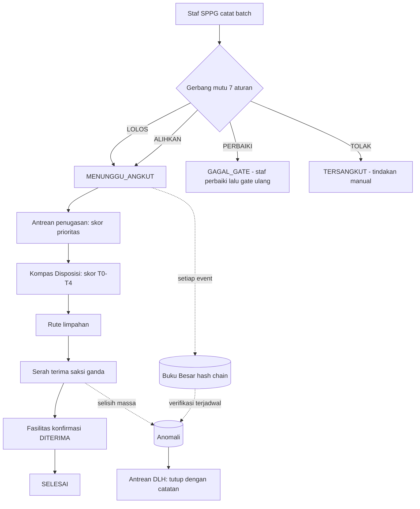

# ARGUS Backend

Backend ARGUS — lapisan keputusan dan bukti untuk limbah dapur program MBG (Makan Bergizi Gratis). Menyimpan Paspor Batch, Buku Besar massa ber-hash-chain, Kompas Disposisi, Cermin Menu, dan Lapor Warga.

Ditulis dengan NestJS 12, PostgreSQL 16 + TimescaleDB, dan TypeORM. Seluruh proses bisnis bersifat append-only untuk data bukti: sekali dicatat, tidak bisa diubah tanpa jejak.

> Dokumen ini untuk pengembang yang baru masuk. Kontrak teknis mendalam ada di `docs/` — lihat [§16 Dokumentasi terkait](#16-dokumentasi-terkait).

---

## Daftar Isi

1. [Konteks produk](#1-konteks-produk)
2. [Status saat ini](#2-status-saat-ini)
3. [Stack dan kebutuhan](#3-stack-dan-kebutuhan)
4. [Mulai cepat](#4-mulai-cepat)
5. [Akun dan seeding](#5-akun-dan-seeding)
6. [Arsitektur](#6-arsitektur)
7. [Model domain](#7-model-domain)
8. [Kontrak API](#8-kontrak-api)
9. [Keamanan](#9-keamanan)
10. [Skrip operasional](#10-skrip-operasional)
11. [Pekerjaan terjadwal](#11-pekerjaan-terjadwal)
12. [Testing](#12-testing)
13. [Environment](#13-environment)
14. [Deployment dan operasional](#14-deployment-dan-operasional)
15. [Troubleshooting](#15-troubleshooting)
16. [Dokumentasi terkait](#16-dokumentasi-terkait)
17. [Belum selaras (drift)](#17-belum-selaras-drift)

---

## 1. Konteks produk

Sistem ini menjawab satu pertanyaan: **ke mana perginya limbah dapur MBG, berapa massanya, dan apakah bisa dibuktikan.**

Backend menyediakan lima inovasi inti:

| Inovasi | Yang dilakukan backend |
|---|---|
| **Paspor Batch** | Setiap batch limbah punya identitas, komposisi fraksi, hasil gerbang mutu, dan riwayat lengkap |
| **Buku Besar Massa** | Rantai hash SHA-256 append-only; setiap event mengunci event sebelumnya |
| **Kompas Disposisi** | Skor T0–T4 per batch: diolah di tempat, dialihkan, atau ditolak — dengan rincian biaya/risiko |
| **Cermin Menu** | Observasi sisa per item menu + insights nilai rupiah, dengan penanda keyakinan `n` |
| **Lapor Warga** | Tiket publik tanpa login, moderasi DLH, hak jawab SPPG, skor risiko |

Prinsip yang mengikat seluruh kode:

- **Integritas di atas fitur.** Data bukti tidak pernah di-`UPDATE` diam-diam; koreksi menambah baris baru.
- **Jujur soal ketidaktahuan.** Parameter yang belum dikalibrasi menghasilkan putusan T4 dengan alasan `PARAMETER_BELUM_TERKALIBRASI`, bukan angka tebakan.
- **Fail-closed pada keamanan.** Produksi menolak start bila rahasia wajib kosong.
- **Privasi anak adalah batas keras.** Tidak ada nama siswa, NISN, kelas, atau foto per individu di skema mana pun.

---

## 2. Status saat ini

| Metrik | Nilai |
|---|---|
| Endpoint HTTP | **84** |
| Direktori modul | **31** (27 domain + `common`, `config`, `database`, `analytics`) |
| Migrasi SQL | **10** |
| Unit test | **316 lulus** di **48 suite** |
| Runtime | Node.js **24.x** (lihat `engines`), ESM penuh |
| Basis data | PostgreSQL 16 + TimescaleDB 2.30.2 |

Fase eksekusi (docs/01 §5): **A–K selesai**, termasuk pengerasan (audit log, retensi, verifikasi rantai terjadwal, DEMO_MODE, narasi LLM, ekspor PDF, struk publik).

Yang belum dikerjakan: `test/app.e2e-spec.ts` otomatis (K5) — verifikasi e2e saat ini dijalankan manual terhadap server hidup. Lihat [§17](#17-belum-selaras-drift).

---

## 3. Stack dan kebutuhan

### Runtime dan framework

| Komponen | Versi | Catatan |
|---|---|---|
| Node.js | 24.x | `engines` di `package.json`; proyek memakai ESM penuh |
| NestJS | 12.1.3 | `@nestjs/common`, `core`, `platform-express` |
| TypeORM | 1.1.2 | `synchronize: false` — skema hanya lewat migrasi SQL |
| PostgreSQL | 16 | dengan ekstensi TimescaleDB |
| TimescaleDB | 2.30.2 | hypertable `telemetry` + columnstore policy |
| TypeScript | 6.0.x | alias paket `@typescript/typescript6`; target ES2021 |

### Dependensi utama

| Paket | Fungsi |
|---|---|
| `@nestjs/jwt` + `passport-jwt` | Autentikasi JWT HS256, masa hidup 8 jam |
| `@nestjs/throttler` | Rate limit global dan per-endpoint |
| `@nestjs/schedule` | Cron verifikasi rantai dan retensi |
| `@nestjs/microservices` + `mqtt` | Ingest telemetri armada dan timbangan |
| `@aws-sdk/client-s3` + `s3-request-presigner` | Salah satu penyedia penyimpanan foto (S3/MinIO); dua lainnya memakai API HTTPS langsung |
| `sharp` | Strip metadata EXIF, verifikasi dimensi, dan kompresi ulang foto |
| `bcrypt` | Hash kata sandi (cost 12) |
| `class-validator` + `class-transformer` | Validasi DTO |
| `pdf-lib` | Ekspor laporan audit PDF |
| `nanoid` + `uuid` | Slug publik dan UUIDv7 |
| `helmet` + `compression` | Header keamanan dan kompresi |

### Catatan ESM

`package.json` memakai `"type": "module"`. Semua impor relatif **wajib** berakhiran `.js` walaupun berkasnya `.ts`:

```ts
import { Batch } from '../database/entities/batch.entity.js';
```

Tanpa ekstensi, build akan gagal dengan `ERR_MODULE_NOT_FOUND` saat runtime.

### Tanpa dependensi untuk hal kecil

Proyek tidak memakai library untuk: haversine, canonical JSON, hash chain, CSV, transformasi nilai desimal. Semuanya ditulis sendiri di `src/common/utils/` dan diuji — lihat aturan di docs/06 §3.1.

---

## 4. Mulai cepat

### Prasyarat

- Node.js 24.x
- PostgreSQL 16 dengan ekstensi TimescaleDB (lokal atau container)
- Broker MQTT (opsional untuk pengembangan — tanpa broker, aplikasi tetap jalan dan hanya mencatat peringatan)

### Langkah

```bash
# 1. Dependensi
npm install

# 2. Konfigurasi
cp .env.example .env
#    Isi minimal: DB_HOST, DB_PORT, DB_NAME, DB_USER, DB_PASSWORD
#    Untuk produksi: JWT_SECRET, IP_HASH_SALT, DEVICE_SECRET_ENC_KEY,
#    STRUK_TOKEN_SECRET (aplikasi menolak start bila kosong)

# 3. Skema
npm run migration:run

# 4. Akun pertama (lihat §5)
npm run seed:demo                      # admin + data demo opsional
SEED_DEMO=true npm run seed:demo       # admin + SPPG/fasilitas demo

# 5. Jalankan
npm run dev                            # mode watch
npm run build && npm run start:prod    # mode produksi
```

### Verifikasi

```bash
curl -s localhost:3001/health
# {"status":"ok", ...}  — health TIDAK memakai prefix /api/v1

curl -s -X POST localhost:3001/api/v1/auth/login \
  -H 'content-type: application/json' \
  -d '{"username":"admin","password":"<kata sandi dari seed>"}'
# {"data":{"accessToken":"...","user":{...}},"success":true}
```

### Menyalakan PostgreSQL + TimescaleDB cepat

```bash
docker run -d --name argus-db \
  -e POSTGRES_USER=argus -e POSTGRES_PASSWORD=argus -e POSTGRES_DB=argus \
  -p 5432:5432 timescale/timescaledb:2.30.2-pg16
```

---

## 5. Akun dan seeding

Ada **dua** jalur seeding. Keduanya idempoten — menjalankan dua kali tidak menggandakan data.

### 5.1 `seed:demo` — akun admin + data contoh

```bash
npm run seed:demo
```

| Variabel | Fungsi |
|---|---|
| `SEED_ADMIN_USERNAME` | default `admin` |
| `SEED_ADMIN_PASSWORD` | Bila kosong: kata sandi acak dicetak **sekali**. Wajib diisi saat `NODE_ENV=production` (min 12 karakter) |
| `SEED_DEMO` | `true` → tambah 1 SPPG + 2 titik distribusi + 2 fasilitas, semua `is_demo=true` |

Bila username sudah ada, kata sandi **tidak** direset — aman dijalankan berulang.

### 5.2 `seed:akun` — akun peran lain dari berkas JSON

Untuk staf dapur, pengemudi, fasilitas, dan auditor DLH.

```bash
npm run seed:akun -- akun-pilot.json --dry-run   # lihat rencana, tidak menulis
npm run seed:akun -- akun-pilot.json             # jalankan
```

Bentuk berkas (contoh lengkap: `akun-pilot.json`; tambahkan `akun-*.json` ke `.gitignore` bila berisi kata sandi nyata — berkas `akun-pilot.json` sudah diabaikan secara default):

```json
{
  "akun": [
    {
      "username": "staff_cibiru",
      "nama": "Staf SPPG Cibiru",
      "role": "sppg_staff",
      "sppgSlug": "2h2ynxp5cfcu",
      "password": ""
    },
    {
      "username": "driver_bandung",
      "nama": "Pengemudi Bandung",
      "role": "driver",
      "fleetKode": "RT-01",
      "password": ""
    },
    {
      "username": "fasilitas_komposter",
      "nama": "Operator Komposter",
      "role": "facility",
      "fasilitasNama": "Komposter Demo SPPG",
      "password": ""
    },
    {
      "username": "audit_dlh",
      "nama": "Auditor DLH Kota",
      "role": "dlh_auditor",
      "password": ""
    }
  ]
}
```

**Binding resource** — pilih salah satu bentuk per baris:

| Peran | Binding wajib | Alternatif ramah operator |
|---|---|---|
| `sppg_staff` | `sppgId` (UUID) | `sppgSlug` (12 karakter, dari `GET /sppg`) |
| `facility` | `fasilitasId` (UUID) | `fasilitasNama` (persis, case-sensitive) |
| `driver` | — | `fleetKode` (mis. `RT-01`) atau `fleetId` |
| `admin`, `dlh_auditor` | **tidak boleh** ada binding | — |

**Kata sandi** — `password: ""` atau dihilangkan → dibuat acak dan **dicetak sekali**. Bila diisi, nilainya tidak pernah dicetak. Minimal 8 karakter (pengembangan) / 12 karakter (produksi).

**Exit code** — `0` sukses, `1` ada baris gagal (mis. slug tidak ditemukan), `2` argumen atau berkas tidak sah.

**Validasi mencerminkan batasan database.** Skrip menolak lebih awal apa yang akan ditolak PostgreSQL: staf tanpa dapur, fasilitas tanpa fasilitas, auditor dengan binding, username duplikat dalam satu berkas, UUID cacat, nama dengan karakter kendali.

### 5.3 Melihat slug dan kode yang tersedia

```bash
# slug dapur
psql -c "SELECT nama, public_slug FROM sppg ORDER BY nama;"

# nama fasilitas
psql -c "SELECT nama, tingkat FROM fasilitas ORDER BY nama;"

# kode armada
psql -c "SELECT kode, kapasitas_kg FROM fleet ORDER BY kode;"
```

Atau lewat API sebagai admin: `GET /api/v1/sppg`, `GET /api/v1/facilities`, `GET /api/v1/fleet`.

### 5.4 Lima peran dan cakupannya

| Peran | Melihat | Menulis |
|---|---|---|
| `admin` | Semua | Semua, termasuk parameter, perangkat, retensi, verifikasi rantai |
| `dlh_auditor` | Semua (baca) | Verifikasi ledger, moderasi tiket, tutup anomali, ekspor |
| `sppg_staff` | Dapurnya saja | Catat batch, event ledger dapurnya, observasi menu, jawab tiket |
| `driver` | Rutenya saja | Konfirmasi stop, event serah-terima sisi kirim |
| `facility` | Fasilitasnya saja | Profil penerimaan, konfirmasi terima/proses |

`facility` dan `driver` tidak diizinkan mengekspor data dan tidak diizinkan melihat audit log.

---

## 6. Arsitektur

### 6.1 Alur hidup satu batch



### 6.2 Modul

| Modul | Tanggung jawab |
|---|---|
| `auth` | Login JWT, profil `GET /auth/me`, bcrypt cost 12 |
| `sppg` | Master dapur + titik distribusi |
| `facility` | Master fasilitas + profil penerimaan ber-versi |
| `batch` | Paspor batch, gerbang mutu 7 aturan, gate ulang |
| `ledger` | Buku besar append-only, transfer saksi ganda, verifikasi rantai |
| `disposition` | Skor Kompas T0–T4, antrean harian, rincian kandidat |
| `menu` | Item menu, penyajian, observasi sisa, insights |
| `tickets` | Lapor warga: endpoint publik + moderasi internal |
| `struk` | Tautan struk publik bertanda tangan (HMAC) |
| `routing` | Rencana rute, optimizer client, fallback greedy, replan, penutupan stop |
| `dispatch` | Antrean penugasan batch ke armada: skor prioritas, pemilihan kendaraan, penugasan otomatis |
| `maps` | Rute berlapis lalu lintas: Google Routes, Mapbox, OSRM, fallback garis lurus |
| `fleet` | Master armada, liveness, posisi |
| `device` | Kredensial perangkat (tracker + timbangan), revokasi, rotasi secret |
| `telemetry` | Ingest telemetri, watchdog liveness, ingest timbangan HMAC, antrean pending |
| `sync` | Sinkronisasi batch dari antrean offline klien |
| `photo` | Unggah foto, sanitasi gambar, penyedia penyimpanan, URL bertanda tangan |
| `dashboard` | Ringkasan per peran, narasi opsional, perbandingan keputusan |
| `anomaly` | Antrean anomali DLH, penutupan dengan catatan |
| `analytics` | Bridge layanan analitik + pemindaian digit tidak wajar |
| `export` | Ekspor CSV dan PDF laporan audit + kuota harian |
| `parameter` | Registri koefisien kalibrasi + status sumber |
| `audit` | Jejak tindakan admin (append-only) + kuota berbasis audit |
| `chain` | Verifikasi rantai terjadwal dan manual |
| `retention` | Retensi telemetri dan foto |
| `llm` | Narasi dashboard (opsional, mati bila tanpa API key) |
| `ops` | Notifikasi operasional via webhook |
| `mqtt` | Koneksi broker, langganan topik |
| `health` | Probe status untuk reverse proxy |

### 6.3 Penyimpanan foto

Penyimpanan dipilih lewat `STORAGE_DRIVER`; antarmuka `StorageProvider` (`has`, `put`, `get`, `delete`) membuat modul `photo` tidak tahu penyedia mana yang aktif.

| Driver | Syarat | Perilaku |
|---|---|---|
| `filesystem` (default) | `STORAGE_DIR` | Tulis atomik (berkas sementara lalu `rename`), shard 2 karakter dari hash, mode `600` |
| `s3` | `S3_ENDPOINT`, `S3_BUCKET`, kredensial | Signed URL S3/MinIO |
| `cloudinary` | `CLOUDINARY_*` | Unggah `type=authenticated`, URL pengiriman bertanda tangan `s--sig--`, hapus lewat Admin API |

Terlepas dari driver, klien **tidak pernah** menerima URL storage mentah. Foto disajikan backend:

```
GET /api/v1/photos/file/:sha256?exp=<unix>&sig=<hmac>
```

Tanda tangan HMAC-SHA256 (32 hex) dari `sha256|exp` dengan `PHOTO_URL_SECRET`, berlaku `PHOTO_SIGNED_URL_TTL_SECONDS` (default 900). Tanda tangan salah atau kedaluwarsa → 403, bukan 404, supaya penyebabnya jelas. Endpoint ini `@Public` karena dipakai di struk dan laporan warga yang tidak punya sesi.

Batas ukuran `PHOTO_MAX_BYTES` (2 MB) diperiksa sebelum gambar disentuh. `sharp` membuang EXIF dan menormalkan orientasi — foto lapangan sering membawa metadata lokasi yang tidak perlu disebar.

### 6.4 Rute dan lalu lintas

`GET /maps/route` mengembalikan alternatif rute beserta kondisi lalu lintas, dengan rantai penyedia yang jujur soal sumbernya:

| Urutan | Penyedia | Syarat | `provider` dilaporkan |
|---|---|---|---|
| 1 | Google Routes API v2 | `GOOGLE_MAPS_API_KEY` | `google` |
| 2 | Mapbox Directions (`driving-traffic`) | `MAPBOX_TOKEN` | `mapbox` |
| 3 | OSRM | `OSRM_BASE_URL` | `osrm` |
| 4 | Garis lurus | selalu tersedia | `straight` |

`ROUTING_TRAFFIC=true` meminta `TRAFFIC_AWARE_OPTIMAL` ke Google. `provider: straight` bukan kegagalan yang disembunyikan: respons tetap membawa jarak, tetapi tanpa klaim lalu lintas, dan UI wajib menyebutnya apa adanya.

Kegagalan satu penyedia tidak menggagalkan permintaan; rantai berlanjut. Hasil disimpan di cache memori 45 detik dengan 96 entri — cukup untuk menahan polling pengemudi tanpa menyajikan data basi.

Setiap alternatif membawa `distanceMeters`, `durationSeconds`, `congestion` (`lancar` | `padat` | `macet`), `congestionScore`, dan `legs`. Ambang label: `<0,15` lancar, `<0,4` padat, sisanya macet.

### 6.5 Antrean penugasan (dispatch)

Modul `dispatch` menjawab pertanyaan yang sebelumnya tidak terjawab: batch menunggu angkut, lalu siapa yang mengambil, kapan, dan mengapa batch itu lebih dulu.

**Skor prioritas** dihitung dari empat komponen berbobot tetap:

```
prioritas = 0,34 x umur + 0,18 x gerbang + 0,18 x berat + 0,30 x jangkauan
```

| Komponen | Sumber |
|---|---|
| Umur | Jam sejak batch dicatat, makin tua makin tinggi |
| Gerbang | Skor per hasil: `PERBAIKI` 88, `ALIHKAN` 70, `LOLOS` 50 — batch yang butuh perbaikan paling mendesak diambil lebih dulu |
| Berat | Massa batch terhadap batas tampung |
| Jangkauan | Jarak ke kandidat armada; batch yang tak terjangkau naik karena butuh keputusan manusia |

Faktor pembusukan dikalikan sesuai kombinasi `flow` dan kadar air. Batch berstatus `TOLAK` tidak pernah masuk antrean — `eligible: false` beserta alasannya.

**Pemilihan kendaraan** menyaring kapasitas dulu (tidak ada penugasan yang membuat muatan melebihi kapasitas), lalu memberi penalti pada armada yang lama tidak bergerak dan yang sudah punya banyak stop terbuka, lalu memilih ETA terendah.

Matriks jarak memakai Mapbox bila titik ≤ 10; di atas itu haversine, karena matriks besar mahal dan tidak sepadan untuk papan antrean. Respons menyebut `matrixSource` (`mapbox` atau `haversine`) supaya ETA tidak diklaim lebih presisi daripada sumbernya.

| Endpoint | Perilaku |
|---|---|
| `GET /dispatch/board` | Batch menunggu tanpa stop terbuka + armada aktif beserta sisa kapasitas dan ETA |
| `POST /dispatch/assign` | Buat stop `AMBIL` pada rencana `AKTIF` hari ini, dengan pemeriksaan kapasitas |
| `POST /dispatch/auto` | Tugaskan otomatis sampai `DISPATCH_MAX_PER_RUN` |

`DISPATCH_AUTO_ON_CREATE=true` membuat batch baru langsung ditugaskan saat dicatat; ini yang membuat pengemudi melihat pekerjaan tanpa menunggu ada yang membuka papan antrean.

**Transisi status yang mudah terlewat:** saat stop `AMBIL` ditandai `SELESAI`, `routing.confirmStop` memindahkan batch dari `MENUNGGU_ANGKUT` ke `DIANGKUT`. Tanpa ini, pengemudi menyelesaikan pekerjaan tetapi batch tetap terlihat menunggu angkut.

### 6.6 Pola implementasi wajib

**1. Mutasi terjaga (guarded mutation).** Semua transisi status memakai CTE sehingga tidak ada balapan:

```sql
WITH updated AS (
  UPDATE tiket_warga SET status = 'SELESAI'
   WHERE id = $1 AND status = 'DITANGGAPI'
  RETURNING id
)
SELECT id FROM updated
```

Nol baris kembali = transisi tidak sah → lempar 409. Ini juga membuat operasi idempoten tanpa lock eksplisit.

**2. Idempotensi offline.** Endpoint yang dipanggil dari antrean offline menerima `clientEventId` (UUID). Duplikat → sukses dengan resource yang sama dan `duplicate: true`.

**3. Hash chain.** `hash = SHA-256(prevHash | canonicalJson(payload))`. `canonicalJson` menstabilkan urutan kunci dan menolak nilai non-finite serta properti accessor — determinisme adalah syarat verifikasi.

**4. Trigger database menolak mutasi data bukti.** `ledger_event` dan `audit_log` punya trigger `no_update` / `no_truncate`. Bahkan `psql` langsung akan ditolak.

**5. Nilai desimal.** Kolom `NUMERIC` dibaca sebagai string oleh driver `pg`; transformator `decimalTransformer` mengubahnya ke `number` di batas entity. Jangan bandingkan `berat_kg` sebagai string.

**6. Urutan berkas.** Fungsi yang tidak memanggil apa pun di atas; fungsi yang memanggil paling banyak di bawah. Berlaku juga untuk urutan blok di dalam berkas.

**7. Tanpa komentar di kode.** Nama fungsi dan tipe harus menjelaskan dirinya. Aturan ini dipegang di seluruh repo.

---

## 7. Model domain

### 7.1 Entity inti

| Tabel | Isi |
|---|---|
| `user` | 5 peran; `sppg_staff` wajib punya `sppg_id`, `facility` wajib punya `fasilitas_id` (ditegakkan CHECK) |
| `sppg` | Dapur sumber limbah + `public_slug` acak 12 karakter |
| `titik_distribusi` | Sekolah/posyandu tujuan sajian |
| `fasilitas` | Penerima & pengolah T1–T4 |
| `profil_penerimaan` | Kontrak penerimaan ber-versi (fraksi, kadar air, kontaminan, `maxAgeHours`) |
| `batch` | Paspor batch: berat, fraksi, hasil gerbang, putusan, status |
| `batch_fraksi` | Komposisi A–E per batch |
| `ledger_event` | Buku besar append-only + hash chain |
| `anomali` | Temuan: neraca massa, durasi umur, digit, rantai, jeda |
| `tiket_warga` + `tiket_event` | Laporan warga + riwayat moderasi |
| `observasi_sisa` | Tingkat sisa per item per titik |
| `fleet` + `device` | Armada dan kredensial perangkat |
| `telemetry` | Hypertable TimescaleDB (posisi, kecepatan, status perangkat) |
| `route_plan` + `route_stop` | Rute limpahan harian |
| `foto` | Metadata foto (konten di object storage) |
| `parameter_kalibrasi` | Koefisien skor + sumber |
| `audit_log` | Jejak tindakan admin, append-only |
| `narasi_dashboard` | Cache narasi LLM |
| `skema_migrasi` | Riwayat migrasi + checksum |

### 7.2 Gerbang mutu (7 aturan)

Batch dievaluasi sebelum masuk antrean. Hasilnya salah satu dari empat status domain — **bukan error**:

| Status | Arti | Aksi sistem |
|---|---|---|
| `LOLOS` | Semua aturan terpenuhi | Lanjut ke `MENUNGGU_ANGKUT` |
| `PERBAIKI` | Ada yang bisa diperbaiki (kadar air, minyak) | `GAGAL_GATE`, staf memperbaiki lalu memanggil gate ulang |
| `ALIHKAN` | Fraksi tidak diterima dapur, tapi bisa dialihkan | Lanjut ke `MENUNGGU_ANGKUT` dengan catatan |
| `TOLAK` | Tidak layak | `TERSANGKUT`, butuh tindakan manual |

Instruksi perbaikan disimpan di `gate_detail` dan dikembalikan langsung ke klien.

### 7.3 Disposisi T0–T4

| Tier | Arti |
|---|---|
| T0 | Tidak ada opsi — tidak ada fasilitas dalam radius |
| T1 | Olah di tempat (kapasitas cukup) |
| T2 | Angkut ke fasilitas terdekat |
| T3 | Angkut ke fasilitas alternatif |
| T4 | **Fallback jujur** — parameter belum terkalibrasi atau data kurang |

T4 bukan kegagalan sistem; itu jawaban benar saat koefisien (biaya per km, penalti umur, dsb.) masih `NULL`. Sistem menolak menebak. Isi parameter lewat `PUT /parameters/:kunci`.

### 7.4 Anomali

| Jenis | Pemicu |
|---|---|
| `NERACA_MASSA` | Selisih serah-terima di luar toleransi |
| `DURASI_UMUR` | Batch melewati `maxAgeHours` profil fasilitas |
| `DIGIT_TIDAK_WAJAR` | Pola digit berat mencurigakan pada satu dapur |
| `RANTAI_TIMPA` | Hash chain tidak konsisten — indikasi manipulasi |
| `JEDA_PENGAMBILAN` | Jarak waktu tidak wajar antar kejadian |

Tingkat: `INFO`, `PERHATIAN`, `KRITIS`. Satu anomali terbuka per (batch, jenis) — partial unique index menjaga ini, jadi verifikasi berulang tidak menggandakan baris.

---

## 8. Kontrak API

### 8.1 Konvensi

| Aspek | Aturan |
|---|---|
| Prefix | `/api/v1` — kecuali `GET /health` |
| Sukses | `{ "data": ..., "timestamp": "...", "success": true }` |
| Error | `{ "success": false, "error": { "code", "message", "details"? }, "timestamp", "path" }` |
| Korelasi | Header `X-Request-Id` dikembalikan di setiap respons |
| Paginasi | `?page=&limit=` → `{ items, total, nextCursor }` |
| Validasi | `whitelist: true`, `forbidNonWhitelisted: true` — properti tak dikenal → 422 |
| Bahasa | Kode dan field camelCase; pesan error bahasa Indonesia |

### 8.2 Peta endpoint

**Publik (tanpa token)**

| Endpoint | Batas |
|---|---|
| `POST /auth/login` | 5/menit |
| `GET /public/sppg/:slug` | 60/menit |
| `POST /public/tickets` | 30/10 menit + 3/jam/IP-hash + 20/hari/SPPG |
| `POST /public/photos` | 10/jam |
| `GET /photos/file/:sha256?exp=&sig=` | tanda tangan HMAC, 900 dtk |
| `GET /public/struk/:token` | 60/menit |
| `GET /health` | — |

**Master data**

| Endpoint | Peran |
|---|---|
| `GET /sppg`, `GET /sppg/:id` | admin, dlh_auditor, sppg_staff (sendiri) |
| `POST /sppg`, `PATCH /sppg/:id` | admin |
| `POST /sppg/:id/points`, `PATCH /sppg/:id/points/:pointId` | admin |
| `GET /facilities`, `POST /facilities`, `PATCH /facilities/:id` | admin, dlh_auditor |
| `GET /facilities/:id/profile`, `GET /facilities/:id/profile/versions` | admin, dlh_auditor |
| `PUT /facilities/:id/profile` | admin, facility (sendiri) |

**Batch dan ledger**

| Endpoint | Peran |
|---|---|
| `POST /batches`, `GET /batches`, `GET /batches/:id` | scoped per peran |
| `POST /batches/:id/gate` | admin, sppg_staff (sendiri) |
| `POST /batches/:id/struk-link` | admin, dlh_auditor, sppg_staff |
| `GET /ledger/recent` | admin, dlh_auditor |
| `GET /ledger/:batchId` | scoped |
| `POST /ledger/:batchId/events` | per peran & tipe event |
| `POST /ledger/:batchId/transfer/confirm` | saksi sisi penerima |
| `GET /ledger/:batchId/verify` | scoped — **menulis anomali** bila ada temuan |

**Disposisi, rute, menu**

| Endpoint | Peran |
|---|---|
| `GET /dispositions`, `POST /dispositions/run` | admin, dlh_auditor |
| `GET /batches/:id/disposition` | scoped |
| `POST /routes/plan`, `GET /routes`, `GET /routes/:id` | admin, dlh_auditor, driver (sendiri) |
| `PATCH /routes/:id/stops/:stopId` | admin, dlh_auditor, driver |
| `POST /routes/:id/replan` | admin |
| `GET /menu/items`, `GET /menu/servings`, `POST /menu/items`, `POST /menu/servings`, `POST /menu/observations` | sppg_staff, admin |
| `GET /menu/insights` | admin, dlh_auditor, sppg_staff |

**Peta, penugasan, dan dampak**

| Endpoint | Peran |
|---|---|
| `GET /maps/directions` | semua login — satu rute, satu penyedia terpilih |
| `GET /maps/route` | semua login — alternatif + kondisi lalu lintas |
| `GET /dispatch/board` | admin, dlh_auditor, sppg_staff — papan antrean penugasan |
| `POST /dispatch/assign` | admin, dlh_auditor — tugaskan satu batch ke satu armada |
| `POST /dispatch/auto` | admin, dlh_auditor — tugaskan otomatis sampai batas per putaran |
| `GET /dashboard/impact` | admin, dlh_auditor — perbandingan fasilitas terdekat vs keputusan ARGUS |

**Tiket dan anomali**

| Endpoint | Peran |
|---|---|
| `GET /tickets`, `GET /tickets/:id` | dlh_auditor, admin, sppg_staff (sendiri) |
| `POST /tickets/:id/verify` | dlh_auditor, admin |
| `POST /tickets/:id/respond` | admin, sppg_staff (sendiri) |
| `POST /tickets/:id/close` | dlh_auditor, admin |
| `GET /anomalies`, `POST /anomalies/:id/close` | dlh_auditor, admin |
| `POST /anomalies/digit-scan` | admin, dlh_auditor |

**Armada dan perangkat**

| Endpoint | Peran |
|---|---|
| `GET /fleet`, `GET /fleet/:id`, `GET /fleet/:id/positions` | admin, dlh_auditor |
| `POST /fleet`, `PATCH /fleet/:id` | admin |
| `GET /devices`, `GET /devices/:id`, `POST /devices` | admin |
| `POST /devices/:id/revoke`, `POST /devices/:id/rotate-secret` | admin |
| `GET /telemetry/:fleetId/latest` | admin, dlh_auditor |
| `GET /scale/pending`, `GET /scale/pending/:id` | admin, dlh_auditor |
| `POST /scale/pending/:id/link` | admin |

**Operasional dan ekspor**

| Endpoint | Peran |
|---|---|
| `GET /dashboard/summary` | semua login (scoped) |
| `GET /dashboard/narrative` | semua login — throttle 20/menit |
| `GET /export/batches.csv`, `GET /export/batches.pdf` | admin, dlh_auditor — 10/hari/aktor (kuota bersama) |
| `GET /parameters` | admin, dlh_auditor |
| `PUT /parameters/:kunci` | admin |
| `GET /audit` | admin |
| `POST /chain/verify` | admin |
| `POST /retention/run` | admin |
| `POST /sync/batch` | semua login |

> Katalog lengkap dengan DTO dan kode error: `docs/03-kontrak-api-dan-dto.md`.

### 8.3 Kode error

| Kode | HTTP | Kapan |
|---|---|---|
| `SYS_VALIDATION` | 422 | Bentuk payload tidak sah |
| `SYS_NOT_FOUND` | 404 | Rute tidak ada |
| `SYS_INTERNAL` | 500 | Bug — sertakan `X-Request-Id` saat melapor |
| `SYS_UNAVAILABLE` | 503 | Dependensi mati (optimizer, storage) |
| `AUTH_INVALID` | 401 | Kredensial salah atau akun nonaktif |
| `AUTH_SESSION_EXPIRED` | 401 | Token kedaluwarsa |
| `RBAC_FORBIDDEN` | 403 | Peran tidak diizinkan |
| `BATCH_NOT_FOUND`, `BATCH_ID_CONFLICT`, `BATCH_WEIGHT_RANGE` | 404/409/422 | Batch |
| `LEDGER_TRANSITION_INVALID`, `LEDGER_HASH_MISMATCH` | 409 | Buku besar |
| `TICKET_RATE_LIMITED`, `EXPORT_RATE_LIMITED`, `NARRATIVE_RATE_LIMITED` | 429 | Kuota |
| `ANOMALY_CLOSED`, `ANOMALY_NOT_FOUND` | 409/404 | Anomali |
| `PARAMETER_VALUE_INVALID` | 422 | Nilai parameter ditolak |
| `STRUK_NOT_FOUND`, `STRUK_EXPIRED` | 404/410 | Tautan struk |

### 8.4 Kontrak sinkronisasi offline

`POST /sync/batch` menerima maksimum 50 item per panggilan, tiap item punya `clientEventId`. Hasil per item: `DITERIMA`, `DUPLIKAT`, atau `DITOLAK` dengan alasan. Klien menampilkan item `DITOLAK` di kelompok "Perlu koreksi" — tidak boleh dibiarkan menumpuk.

---

## 9. Keamanan

### 9.1 Ringkasan kontrol

| Lapisan | Kontrol |
|---|---|
| Transport | TLS di reverse proxy; HSTS di produksi |
| Header | `helmet` dengan CSP ketat (`default-src 'none'`), `frame-ancestors 'none'`, `no-referrer` |
| CORS | Hanya `FRONTEND_URL`; `credentials: false` (token lewat header) |
| Autentikasi | JWT HS256, 8 jam (satu shift kerja), tanpa refresh token — keputusan sadar |
| Otorisasi | Guard global + scoping resource di service (bukan hanya di guard) |
| Input | DTO + `ValidationPipe` global; 100% query berparameter |
| Kata sandi | bcrypt cost 12; pesan login selalu generik |
| Perangkat | HMAC-SHA256 per perangkat timbangan; secret disimpan terenkripsi AES-256-GCM |
| Data bukti | Trigger database menolak UPDATE/DELETE/TRUNCATE |
| Audit | `audit_log` append-only untuk semua mutasi admin dan dlh_auditor |
| Rate limit | Global 100/menit + batas per kelas endpoint |
| Error | Pesan generik untuk 401/403; detail lengkap hanya di log |

### 9.2 Data pribadi

Yang disimpan:

| Data | Tempat | Perlindungan |
|---|---|---|
| `driver_kontak` | `fleet` | Hanya admin; tidak pernah masuk log, prompt LLM, atau ekspor |
| `ip_hash` | `tiket_warga` | SHA-256 + salt bulanan; tidak pernah diserialisasi ke respons |
| Koordinat pelapor | `tiket_warga` | Hanya di peta internal DLH |
| Nama aktor | `ledger_event.aktor` | Untuk akuntabilitas internal |

Yang **tidak pernah** disimpan: nama siswa, NISN, kelas, foto wajah anak, kontak warga, alamat email pelapor.

### 9.3 Anti-SSRF pada layanan eksternal

`LLM_BASE_URL` divalidasi saat bootstrap dan saat dipakai: menolak URL berkredensial, berquery, atau berfragment; di produksi wajib `https` dan host non-privat (termasuk `169.254.169.254` metadata cloud). Pola yang sama dipakai untuk klien optimizer dan analytics.

### 9.4 Kuota ekspor

Kuota 10 ekspor/hari/aktor dihitung dari `audit_log` dalam satu statement atomik dengan advisory lock — tidak bisa dilewati dengan permintaan paralel. CSV dan PDF berbagi kuota yang sama; formatnya dibedakan di kolom `detail`.

---

## 10. Skrip operasional

| Skrip | Fungsi |
|---|---|
| `npm run build` | Kompilasi produksi ke `dist/` |
| `npm run dev` | Mode watch |
| `npm run start:prod` | Jalankan `dist/main.js` |
| `npm test` | Unit test (316 tes) |
| `npm run test:cov` | Unit test + coverage |
| `npm run test:e2e` | Kerangka e2e (belum berisi skenario — lihat §17) |
| `npm run lint` / `format` | ESLint / Prettier |
| `npm run migration:run` | Terapkan migrasi tertunda |
| `npm run migration:status` | Daftar migrasi tertunda |
| `npm run seed:demo` | Akun admin (+ data demo opsional) |
| `npm run seed:akun -- <berkas.json>` | Akun peran lain dari berkas JSON |
| `npm run broker:export` | Hasilkan `passwd` + `acl` Mosquitto dari tabel `device` |
| `npm run verify:chains` | Verifikasi rantai manual (`--batch <uuid>`, `--limit`, `--sample`) |

### `verify:chains` — untuk drill restore

```bash
npm run verify:chains                       # 100 batch terbaru + sampel 5%
npm run verify:chains -- --batch <uuid>     # satu batch
npm run verify:chains -- --limit 500 --sample 10
```

Exit code `0` = semua utuh, `1` = ada yang timpa, `2` = argumen salah. Ini satu-satunya cara memenuhi aturan operasional "restore tanpa verifikasi rantai dianggap restore gagal".

### `broker:export`

Menghasilkan dua berkas dari tabel `device`:

- `passwd` — hash Mosquitto untuk setiap perangkat
- `acl` — izin topik per perangkat (`scale/<deviceId>/weight` dan `fleet/+/telemetry`)

Jalankan setelah menambah, mencabut, atau merotasi perangkat, lalu muat ulang broker.

---

## 11. Pekerjaan terjadwal

| Cron | Waktu WIB | Yang dilakukan |
|---|---|---|
| `chain-verify-daily` | 04:00 | Verifikasi 100 batch terbaru + sampel deterministik; gagal → anomali KRITIS + webhook |
| `retention-daily` | 02:30 | Selaraskan columnstore policy, `drop_chunks` telemetri, purge foto kedaluwarsa |
| Watchdog armada | setiap 60 detik | Ubah status armada STALE/OFFLINE berdasarkan `last_device_timestamp` |
| Sweep timbangan pending | setiap 300 detik | Bersihkan antrean penimbangan yang kedaluwarsa |

Semua bisa dipicu manual oleh admin (`POST /chain/verify`, `POST /retention/run`) — penting saat insiden, ketika menunggu jam 04:00 tidak masuk akal.

### Notifikasi operasional

`OPS_WEBHOOK_URL` menerima payload JSON untuk: anomali KRITIS baru, verifikasi rantai gagal, retensi gagal. Kosong = fitur mati. `OPS_ALERT_COOLDOWN_SECONDS` menahan notifikasi berulang.

### Retensi

| Data | Default | Variabel |
|---|---|---|
| Telemetri (compress) | 7 hari | `TELEMETRY_COMPRESS_AFTER_DAYS` |
| Telemetri (drop) | 90 hari | `TELEMETRY_DROP_AFTER_DAYS` |
| Foto tiket | 366 hari | `PHOTO_TICKET_RETENTION_DAYS` |
| Foto batch | 731 hari | `PHOTO_BATCH_RETENTION_DAYS` |

`RETENTION_PURGE_ENABLED=false` secara default — job berjalan dalam mode laporan saja. Menghapus foto adalah tindakan destruktif; aktifkan hanya setelah kebijakan retensi disetujui.

---

## 12. Testing

```bash
npm test          # 316 tes, 48 suite, sekitar 5 detik
npm run test:cov  # dengan coverage
```

Cakupan unit test berfokus pada **fungsi murni** — bagian yang paling mudah salah dan paling mahal salahnya:

| Berkas | Yang diuji |
|---|---|
| `hash.util.spec.ts` | Canonical JSON, hash chain, deteksi timpa |
| `gate.service.spec.ts` | 7 aturan gerbang |
| `score.util.spec.ts` | Skor disposisi |
| `mass-balance.util.spec.ts` | Neraca massa |
| `transfer.util.spec.ts` | Saksi ganda |
| `csv.util.spec.ts` | Netralisasi formula spreadsheet |
| `pii-sanitizer.util.spec.ts` | Sensor PII + buang markup |
| `struk-token.util.spec.ts` | Tanda tangan, kedaluwarsa, muatan diubah |
| `akun-seed.util.spec.ts` | Validasi berkas akun |
| `roles.guard.spec.ts` | Matriks peran |
| `optimizer-*.spec.ts` | Kontrak optimizer dan fallback |

### Verifikasi manual (e2e)

Belum ada `test/app.e2e-spec.ts` otomatis. Pola yang dipakai saat ini:

1. Jalankan server terhadap basis data terpisah
2. Login tiap peran, simpan token
3. Uji matriks peran per endpoint (200/403/404/422)
4. Uji alur utama: batch → gate → ledger → transfer → verify
5. Uji jalur gagal: token kedaluwarsa, kuota habis, transisi tidak sah

**Penting saat menguji login:** rate limit login 5/menit. Setelah lima percobaan, respons `429` akan terlihat seperti kredensial salah bila tidak diperiksa. Beri jeda atau restart server untuk mereset penghitung.

---

## 13. Environment

Seluruh variabel ada di `.env.example` dengan nilai contoh. Aturan yang dipegang:

1. **Tidak ada konfigurasi di kode.** Semua lewat `ConfigService`.
2. **Aplikasi menolak start** bila variabel wajib kosong atau tidak sah saat `NODE_ENV=production`. Lebih baik mati saat start daripada rusak saat shift berjalan.
3. **Rahasia tidak pernah masuk image atau repo.**

### Kelompok penting

| Kelompok | Variabel kunci | Catatan |
|---|---|---|
| Aplikasi | `NODE_ENV`, `PORT`, `FRONTEND_URL`, `PUBLIC_APP_URL`, `PUBLIC_API_URL` | `PUBLIC_APP_URL` dipakai membentuk tautan struk; `PUBLIC_API_URL` membentuk URL foto |
| Database | `DB_HOST`, `DB_PORT`, `DB_NAME`, `DB_USER`, `DB_PASSWORD`, `DB_POOL_SIZE`, `DB_SSL` | — |
| Auth | `JWT_SECRET` (min 64), `JWT_EXPIRES_IN`, `BCRYPT_ROUNDS`, `IP_HASH_SALT` (min 32) | Wajib di produksi |
| Perangkat | `DEVICE_SECRET_ENC_KEY` (64 hex) | Kunci AES-256-GCM untuk secret timbangan |
| Struk | `STRUK_TOKEN_SECRET` (min 32), `STRUK_TOKEN_TTL_HOURS` | Rotasi = mencabut semua tautan beredar |
| MQTT | `MQTT_URL`, `MQTT_USERNAME`, `MQTT_PASSWORD`, `MQTT_CA_PATH` | Produksi wajib `mqtts://` |
| Storage foto | `STORAGE_DRIVER`, `STORAGE_DIR`, `PUBLIC_API_URL`, `PHOTO_URL_SECRET`, `PHOTO_SIGNED_URL_TTL_SECONDS`, `PHOTO_MAX_BYTES` | `filesystem` default; `PUBLIC_API_URL` dipakai membentuk URL foto |
| S3/MinIO | `S3_ENDPOINT`, `S3_BUCKET`, `S3_ACCESS_KEY`, `S3_SECRET_KEY` | Hanya bila `STORAGE_DRIVER=s3` |
| Cloudinary | `CLOUDINARY_CLOUD_NAME`, `CLOUDINARY_API_KEY`, `CLOUDINARY_API_SECRET`, `CLOUDINARY_FOLDER` | Hanya bila `STORAGE_DRIVER=cloudinary` |
| Rute | `GOOGLE_MAPS_API_KEY`, `OSRM_BASE_URL`, `ROUTING_TRAFFIC`, `ROUTING_ALTERNATIVES`, `ROUTING_TIMEOUT_MS` | Rantai Google → Mapbox → OSRM → garis lurus |
| Penugasan | `DISPATCH_AUTO_ON_CREATE`, `DISPATCH_MAX_PER_RUN` | Papan antrean dan penugasan otomatis |
| Layanan luar | `OPTIMIZER_URL`, `ANALYTICS_URL`, `MAPBOX_TOKEN`, `LLM_*` | Semua opsional; fitur mati bila kosong |
| Rate limit | `THROTTLE_GLOBAL_PER_MIN`, `TICKET_RATE_*`, `EXPORT_RATE_PER_DAY` | — |
| Operasional | `OPS_WEBHOOK_URL`, `CHAIN_VERIFY_*`, `TELEMETRY_*_DAYS`, `DEMO_MODE` | — |

### Variabel yang sering disalahpahami

| Variabel | Perilaku |
|---|---|
| `DEMO_MODE` | `true` = data `is_demo=true` **disertakan**. Default `false` = data demo disembunyikan dari ringkasan, ekspor, daftar anomali, dan daftar tiket |
| `MIGRATIONS_RUN` | `false` di aplikasi utama. Migrasi dijalankan job terpisah |
| `LLM_API_KEY` | Kosong = narasi mati; endpoint mengembalikan `status: DISABLED` |
| `RETENTION_PURGE_ENABLED` | `false` = mode laporan saja |
| `STORAGE_DRIVER` | `filesystem` menulis ke `STORAGE_DIR`; `s3` dan `cloudinary` mengabaikan folder lokal. Berganti driver tidak memindahkan foto lama |
| `ROUTING_TRAFFIC` | `false` = Google diminta tanpa `TRAFFIC_AWARE_OPTIMAL`; waktu tempuh jadi tanpa lalu lintas |
| `DISPATCH_AUTO_ON_CREATE` | `true` = batch baru langsung memperoleh stop `AMBIL` tanpa ada yang membuka papan antrean |

---

## 14. Deployment dan operasional

### Urutan deploy

1. Build image
2. **Job migrasi terpisah** (`npm run migration:run`)
3. Deploy aplikasi
4. Healthcheck `/health`
5. Smoke test: login, satu batch demo di staging

Zero-downtime tidak diklaim untuk fase ini. Downtime terjadwal di jendela dini hari.

### Backup dan restore

| Data | Strategi |
|---|---|
| PostgreSQL | `pg_dump` harian + WAL archiving; 30 harian + 12 bulanan |
| Foto — `filesystem` | Salin `STORAGE_DIR` (rsync/restic) ke lokasi kedua; struktur shard 2 karakter membuat salinan inkremental murah |
| Foto — `s3` | Replikasi bucket (versioning + cross-region replication) |
| Foto — `cloudinary` | Backup bergantung paket akun; unduh berkas asli secara berkala ke penyimpanan sendiri |
| Verifikasi pasca-restore | `npm run verify:chains` pada sampel batch |

**Aturan: restore tanpa verifikasi rantai dianggap restore gagal.** Bukti yang tidak bisa diverifikasi bukan bukti.

### Runbook mini

| Kejadian | Langkah |
|---|---|
| Kecurigaan manipulasi ledger | **Jangan menyentuh baris.** Bekukan batch (`TERSANGKUT`), kumpulkan log + backup, verifikasi dari read-only, catat temuan sebagai event koreksi baru, lapor DLH |
| Optimizer mati | Tidak ada aksi darurat — rute masuk `NEEDS_MANUAL_SCHEDULING`, admin menyusun manual dari daftar T2/T3 |
| Perangkat hilang | `POST /devices/:id/revoke` → jalankan `broker:export` → muat ulang broker |
| Salah input berat | Koreksi oleh admin sebagai **event baru** dengan alasan; nilai lama tetap terlihat |
| DLH minta ekspor | `GET /export/batches.csv` atau `.pdf` → tercatat di audit → kirim via kanal resmi |
| Verifikasi rantai gagal | Ikuti notifikasi webhook; periksa `GET /anomalies?jenis=RANTAI_TIMPA` |

---

## 15. Troubleshooting

### Aplikasi menyambung ke basis data yang salah

**Gejala:** perintah `npm run` menulis ke DB yang tidak diharapkan; data "hilang".

**Sebab:** Node.js `--env-file` **tidak menimpa** variabel yang sudah ada di lingkungan shell. Bila `DB_PORT` pernah di-`export` di sesi terminal itu, nilai itulah yang menang.

**Solusi:**

```bash
env -u DB_HOST -u DB_PORT -u DB_NAME -u DB_USER -u DB_PASSWORD \
  npm run seed:akun -- akun-pilot.json
```

Atau buka terminal baru sebelum menjalankan perintah penting.

### `MIGRASI_BERUBAH: <nama>.sql berubah setelah diterapkan`

**Sebab:** berkas migrasi disunting setelah diterapkan, sehingga checksum tidak cocok. Runner menolak agar skema tidak diam-diam berbeda antar lingkungan.

**Solusi:** jangan mengubah migrasi yang sudah diterapkan — buat migrasi baru. Bila perubahan memang disengaja pada lingkungan pengembangan:

```sql
UPDATE skema_migrasi
   SET checksum = '<sha256 berkas saat ini>'
 WHERE nama = '<nama>.sql';
```

Cek dengan `sha256sum src/database/migrations/<nama>.sql`.

### Login selalu gagal padahal kredensial benar

**Sebab paling umum:** rate limit 5/menit tercapai (respons `429`), atau kata sandi memang belum pernah dicetak ulang.

**Diagnosis:**

```bash
curl -i -X POST localhost:3001/api/v1/auth/login \
  -H 'content-type: application/json' \
  -d '{"username":"admin","password":"..."}'
```

Perhatikan status HTTP. `429` = throttle, bukan kredensial. `401` = kredensial atau akun nonaktif.

### Lupa kata sandi akun

Tidak ada endpoint reset. Jalur yang tersedia:

1. `npm run seed:demo` — hanya untuk `admin`, dan **tidak** mereset bila username sudah ada
2. `npm run seed:akun -- <berkas.json>` — hanya membuat akun baru, tidak mengubah yang lama
3. SQL langsung dengan hash bcrypt baru — pilihan terakhir, catat di log perubahan

### `seed:akun` melaporkan "slug dapur tidak ditemukan"

Slug adalah 12 karakter acak dari `GET /sppg` atau `SELECT public_slug FROM sppg`. Placeholder seperti `ganti-dengan-slug-dapur` memang akan gagal — itu perilaku benar.

Hal yang sama berlaku untuk `fasilitasNama` (harus persis, case-sensitive) dan `fleetKode`.

### MQTT error berulang tetapi aplikasi jalan

Normal bila broker belum dinyalakan. Ingest telemetri tidak aktif, sisanya berfungsi. Nyalakan broker, atau abaikan di pengembangan.

### Foto mengembalikan 403, 404, atau 503

| Status | Sebab yang paling sering |
|---|---|
| 403 | `exp` sudah lewat atau `sig` tidak cocok — URL lama, atau `PHOTO_URL_SECRET` berubah sehingga semua tautan beredar dicabut |
| 404 | Baris `foto` ada tetapi berkasnya tidak ada di penyimpanan: `STORAGE_DRIVER` diganti, atau `STORAGE_DIR` dipindah tanpa memindahkan berkas |
| 503 | Penyedia tidak terjangkau. Untuk `filesystem`, periksa izin dan keberadaan `STORAGE_DIR`; untuk `s3`/`cloudinary`, periksa kredensial |

Mengganti driver **tidak** memindahkan foto lama. Bila perlu berpindah, salin berkas terlebih dahulu, baru ubah `STORAGE_DRIVER` — dan ingat `sha256` adalah kunci nama berkas, sehingga salinan bisa diverifikasi per berkas.

### Waktu terlihat meleset

Semua waktu disimpan sebagai `TIMESTAMPTZ` (UTC). Konversi ke WIB (UTC+7) dilakukan saat menampilkan. Ekspor CSV dan laporan PDF memakai tanggal WIB, sehingga batch pukul 23:00 WIB masuk ke tanggal yang benar, bukan hari berikutnya UTC.

---

## 16. Dokumentasi terkait

| Berkas | Isi |
|---|---|
| `docs/00-AI-EXECUTION-RULES.md` | Aturan global, keputusan yang dikunci, pagar ruang lingkup |
| `docs/01-arsitektur-dan-file-plan.md` | Dependency graph modul, alur end-to-end, penamaan, file plan |
| `docs/02-database-dan-entities.md` | Entity, bentuk kanonik profil, indeks, state machine |
| `docs/03-kontrak-api-dan-dto.md` | Katalog endpoint, DTO, kode error, kontrak FastAPI |
| `docs/04-logika-keputusan-dan-optimasi.md` | Gerbang, skor, hash chain, deteksi anomali, VRPTW, kalibrasi |
| `docs/05-keamanan-dan-error-handling.md` | Threat model, privasi, pemetaan OWASP, rate limit |
| `docs/06-env-dan-ops.md` | Env, layanan, dependensi, deployment, backup, runbook |
| `docs/07-gap-dan-keputusan-terbuka.md` | Keputusan terbuka dan register risiko |
| `docs/08-esp32-dan-timbangan.md` | Firmware tracker + timbangan HX711, kontrak tanda tangan |
| `docs/09-rencana-implementasi.md` | Jadwal, protokol pilot, rencana simulasi, cut-list |
| `docs/10-peta-dossier-ke-implementasi.md` | Keterlacakan inovasi → modul → endpoint → uji |

`docs/arsip-step1/` adalah dokumen lama — hanya untuk konteks historis, bukan rujukan implementasi.

---

## 17. Belum selaras (drift)

Bagian ini jujur menyebut apa yang belum sinkron antara kode, dokumentasi, dan berkas infrastruktur. **Jangan pakai item di bawah tanpa memperbaikinya lebih dulu.**

| Item | Masalah | Dampak |
|---|---|---|
| `docker-compose.yml` | Mengirim `DATABASE_URL` dan `MQTT_BROKER_URL` — aplikasi membaca `DB_HOST/DB_PORT/...` dan `MQTT_URL` | `docker compose up` akan gagal menyambung ke basis data |
| `docker-compose.yml` | Memasang `./config/mosquitto/passwd` yang tidak ada di repo | Mount gagal sebelum container start |
| `Dockerfile` | Basis `node:22-alpine`, sedangkan `engines` menuntut Node 24.x | Build produksi memakai runtime yang tidak sesuai |
| `docs/06` §6 | Menulis retensi telemetri "drop > 12 bulan"; kode memakai 90 hari (`TELEMETRY_DROP_AFTER_DAYS`) | Kebingungan kebijakan |
| `docs/03` §2.11 | Menyebut `GET /parameters` dan `PUT /parameters/:kunci` — keduanya **sudah ada**; `seed:akun` belum terdokumentasi di `docs/06` §4 | Dokumentasi tertinggal dari kode |
| `test/app.e2e-spec.ts` | Kerangka kosong; skenario K5 belum ditulis | Regresi alur utama hanya tertangkap uji manual |
| `dispatch/dispatch.util.ts`, `dashboard/impact.util.ts` | Fungsi skor berbobot tanpa unit test; kebenarannya hanya diverifikasi lewat endpoint hidup | Perubahan bobot bisa lolos tanpa tertangkap |
| `maps/traffic.service.ts` | Rantai penyedia dan fallback belum diuji dengan respons tiruan | Kegagalan penyedia hanya terbukti saat diuji manual |

Perbaikan berkas infrastruktur sebaiknya dikerjakan sebagai satu batch tersendiri, bukan diselipkan.

---

## Lisensi

UNLICENSED — perangkat lunak internal, tidak untuk didistribusikan tanpa izin.
